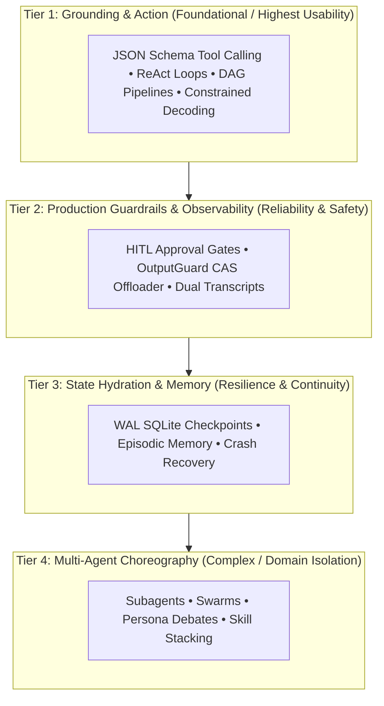

# Agentic AI: The Master Learning & Revision Guide
*From Foundational Mechanics to Production Systems Architecture*

---

## Executive Overview: The Agentic Usability Pyramid

In production engineering, Agentic AI is organized into **four operational tiers**, ordered from the most universally usable, deterministic, and high-ROI foundations up to advanced multi-agent coordination:



---

## Tier 1: Grounding & Action (Foundational — 85%+ of Production Use Cases)

> **Core Value**: Transforms an LLM from a passive statistical text generator into an active software agent capable of deterministic side-effects, real-time data retrieval, and state mutation.

### 1.1 Tool Calling & Structured Outputs Mechanics
* **Tool Schema Contract**: Every tool is defined by a strict JSON Schema (Draft 7 / 2020-12) specifying `name`, `description`, and strictly-typed `parameters` (types, enums, required fields).
* **Constrained Decoding (Grammar-Guided Sampling)**: 
  * Rather than relying on fragile post-hoc string regex parsing, modern backends use Finite State Machines (FSMs) or Context-Free Grammars (CFGs) (e.g., Outlines, XGrammar) to dynamically mask invalid token logits to $-\infty$.
  * **Result**: Guarantees 100% syntactically valid JSON arguments adhering strictly to the Pydantic schema before tokens leave the inference engine.
* **ReAct (Reasoning + Acting) Execution Loop**:
  $$\text{Observe} \longrightarrow \text{Think (LLM)} \longrightarrow \text{Act (Tool Call)} \longrightarrow \text{Observe (Tool Output)}$$
  * **Hard Loop Caps (Rule 1)**: Autonomous `while` loops must always enforce strict iteration limits ($N \le 15$) to prevent infinite token burn during model hallucination loops.
  * **Repetition Detection**: Non-consecutive loop detectors inspect execution history and break early if the model repeats identical failing tool calls.

### 1.2 Parallel Tool Dispatching
* When a model emits $N$ tool calls in a single turn (e.g., fetching 5 database tables):
  * **Bounded Concurrency**: Bounded by an `asyncio.Semaphore` to protect host memory and thread pools.
  * **Sequential Isolation**: Tools that mutate disk or database state are flagged `sequential_only` and executed with a mutex lock to eliminate race conditions.
  * **Order Preservation**: Execution results must be returned in the exact order matching the LLM's request sequence.

### 1.3 Nested & Chained Tool Calling (DAG Wave Execution)
* **The Problem**: Tool B depends on Tool A's output ($A \to B$). In traditional ReAct, this requires two full round-trip LLM inference turns, burning 2–6s of latency and hundreds of input tokens.
* **The Solution**: Single-turn DAG execution (`execute_tool_pipeline` or nested `{"$tool": ..., "$input": ...}`):
  * **Cycle Detection**: Kahn’s algorithm sorts steps into topological execution waves.
  * **Template Path Interpolation**: Steps access upstream results via `{{steps.<id>.output.<path>}}`.
  * **Fault Shielding**: Configurable failure modes (`halt`, `skip_dependents`, `continue`).
  * **Universal Portability**: Declarative execution from YAML/JSON files via `ConfigurablePipelineRunner`.

---

## Tier 2: Production Guardrails & Observability (Reliability & Safety)

> **Core Value**: Ensures agents operate within enterprise compliance boundaries, prevent context window pollution, and maintain complete auditability.

### 2.1 OutputGuard & The Data Pointer Pattern (CAS Offloading)
* **The Problem**: Database queries or web scrapes returning 50 KB–1 MB of raw text exhaust LLM context limits and incur extreme token costs.
* **The Solution**: 
  * Intercept tool return strings before they enter the prompt context.
  * If size exceeds threshold ($> 8\text{ KB}$), write the full payload to a Content-Addressable Storage (CAS) vault hashed by SHA-256 (`cas://<sha256>`).
  * Inject only a concise preview with token bounds into the prompt, accompanied by micro-query tools (`read_pointer_slice`, `query_pointer_json`, `grep_pointer`).

### 2.2 Human-In-The-Loop (HITL) Approval Gates
* Mutating or high-risk actions (sending emails, modifying tables, executing shell commands) require verified review.
* **Two-Way Webhook Acknowledgment**:
  * An HTTP 200 response confirms delivery to the gateway, but does **not** clear reviewer spinners.
  * The handler must asynchronously call the platform acknowledgment API (e.g., Telegram `answerCallbackQuery`) with feedback text.
  * Strict byte bounds (e.g., 64 bytes) must be enforced on callback tokens to prevent logic truncation attacks.

### 2.3 Dual-Transcript Observability
* **`transcript.jsonl` (Compact)**: Truncated parameters and short tool summaries for real-time monitoring and daily debugging.
* **`transcript_full.jsonl` (Complete)**: Full uncompressed JSON payloads, exact model system prompts, and full tool responses for deep trajectory analysis and regression evals.

---

## Tier 3: State Hydration & Memory (Resilience & Continuity)

> **Core Value**: Prevents agents from losing their progress during network timeouts, container restarts, or long-running multi-day workflows.

### 3.1 Checkpoints & Crash Recovery
* **WAL SQLite Persistence**: Saving messages, active tool state, and intermediate variables to a SQLite database operating in Write-Ahead-Logging mode (`journal_mode=WAL`).
* **Resumption Flow**: On restart, the agent hydrates state directly from the last verified checkpoint rather than restarting from step 1.

### 3.2 Episodic vs. Procedural Memory
* **Episodic Memory**: Storing past conversation histories and user preferences across distinct sessions.
* **Procedural Memory (SOPs)**: Standard Operating Procedures stored as modular Markdown documents dynamically injected into the system prompt based on user intent.

---

## Tier 4: Multi-Agent Choreography (Complex Domain Specialization)

> **Core Value**: Solves complex tasks requiring distinct security boundaries, specialized toolsets, or conflicting persona debates.

### 4.1 Sub-Agent Context Sandboxing
* When a primary agent delegates a subtask (e.g. `delegate_to_data_analyst(task="...")`), the parent invokes an isolated child ReAct loop.
* **Benefits**:
  * Child agent context is cleanly sandboxed: hundreds of lines of intermediate code and execution attempts never clutter the parent's context window.
  * Parent receives only the polished final response as a standard tool output.

### 4.2 Cohorts, Swarms & Debates
* **Coordinator-Worker Topology**: A primary coordinator breaks down goals, assigns task slices to specialized workers, and aggregates outcomes.
* **Critic / Judge Validation**: A secondary LLM agent critiques drafts against specific rubric dimensions (Correctness, Robustness, Scope) before release.

---

## Quick Reference: Decision Flowchart

When building or reviewing a new agent capability, follow this priority path:

```
1. Can it be solved deterministically with a Python function or SQL query?
   ├─► YES: Write a standalone deterministic tool. Wrap with LLM tool schema.
   └─► NO: Continue.

2. Does Tool B strictly depend on Tool A's output?
   ├─► YES: Use Nested/Chained DAG Tool Calling (ConfigurablePipelineRunner).
   └─► NO: Continue.

3. Are multiple tool calls independent?
   ├─► YES: Execute concurrently via AsyncToolDispatcher (Bounded Semaphore).
   └─► NO: Continue.

4. Can tool outputs exceed 8 KB?
   ├─► YES: Mount OutputGuard (CAS data pointer offloading).
   └─► NO: Continue.

5. Does the tool mutate data or perform external actions?
   ├─► YES: Gate with HITLApprovalGate (Async Two-Way Webhook).
   └─► NO: Proceed with standard execution.
```
