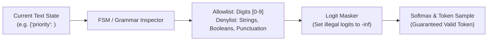

# Provider-Native Structured Outputs & Grammar-Guided Decoding: Architectural Deep Dive

> **Revision Objective**: Provide an end-to-end conceptual and practical reference on how schema-enforced structured generation works at the model and inference engine layers. By reviewing this document, you should clearly understand:
> 1. **The "Why"**: Why prompt-based JSON is fundamentally unsuited for multi-step agentic loops (The Benchmark Trap & Compounding Error Math).
> 2. **The Mechanics**: How constrained decoding physically works at the token-sampling layer via logit masking ($-\infty$) and Finite State Machines (FSM).
> 3. **The Provider Matrix**: How commercial APIs (OpenAI, Anthropic) and open-source runtimes (vLLM, Ollama, Hugging Face Router) implement structured outputs differently.
> 4. **The Architecture**: How our workspace's Tri-Mode Engine (`auto`, `native`, `prompt_injection`) and schema sanitizer (`prepare_strict_json_schema`) achieve universal compatibility.
> 5. **The Pitfalls**: The "Reasoning Penalty" on smaller models and how to mitigate it with Chain-of-Thought schema design.

---

## 1. The "Why": The Benchmark Trap & Agentic Reliability Math

### 1.1 The Mathematical Law of Compounding Errors
In a single conversational chatbot turn, a 5% parsing error rate is a minor inconvenience. A user simply re-prompts the model.

In an autonomous multi-step agent (e.g., ReAct loop, research-draft-critique pipeline, or recursive planning), errors compound exponentially:

$$\text{Success Rate} = (1 - p)^N$$

Where $p$ is the error probability per step, and $N$ is the number of agent steps:

| Single-Turn Reliability ($1-p$) | 5-Step Agent Loop | 10-Step Agent Loop | 15-Step Agent Loop |
|:---:|:---:|:---:|:---:|
| 90% | 59.0% | 34.8% | 20.5% |
| **95% (Typical Prompt JSON)** | **77.3%** | **59.8%** | **46.3%** |
| 99% | 95.1% | 90.4% | 86.0% |
| **100% (Constrained Decoding)** | **100.0%** | **100.0%** | **100.0%** |

At $N = 10$, a model that is 95% reliable on JSON syntax will **fail 4 out of 10 times**. 
Post-hoc regex parsing and repair prompts reduce this risk, but burn tokens, introduce latency, and still fail on severe hallucinations.

### 1.2 The "Benchmark Trap" (Weights vs. Serving Runtime)
A common misconception in AI development is that selecting a top-ranking model on MMLU or HumanEval guarantees a reliable agent.

In production:
- **30% Model Weights**: Semantic reasoning, domain knowledge, world understanding.
- **35% Serving & Inference Engine**: Grammar-constrained logit masking, prefix KV caching, continuous batching.
- **35% Agent Architecture**: State machine persistence, typed contracts, memory consolidation, circuit breakers.

A 70B open-source model running on an unoptimized endpoint without grammar-guided decoding will underperform a 7B model running on a grammar-constrained vLLM stack when downstream processes require deterministic schema parsing.

---

## 2. How Constrained Decoding Physically Works

### 2.1 The Token-Generation Loop
Standard autoregressive language models predict the next token by computing unnormalized log probabilities (logits) over the entire vocabulary $V$ (typically 32,000 to 128,000 tokens):

$$P(t_{k} \mid t_{<k}) = \text{softmax}(z_k) = \frac{\exp(z_{k, i})}{\sum_{j \in V} \exp(z_{k, j})}$$

### 2.2 Logit Masking via Finite State Machines (FSM)
In grammar-guided decoding (pioneered by libraries like `Outlines`, `XGrammar`, and `llama.cpp` GBNF):
1. **Compilation**: Before generation starts, your target JSON Schema or Context-Free Grammar (CFG) is compiled into a **Finite State Machine (FSM)** or pushdown automaton.
2. **State Tracking**: At step $k$, the inference engine inspects the current state of the generated text (e.g., currently expecting a key name, a colon, an open bracket, or an integer).
3. **Logit Masking**: Before applying the softmax function, the engine iterates over vocabulary $V$. For any token $j$ that would drive the FSM into an invalid syntactic state, its logit $z_{k, j}$ is set to $-\infty$:

$$z_{k, j} \leftarrow -\infty \quad \forall j \notin \text{ValidTokens}(\text{state}_k)$$

4. **Guaranteed Legality**: When softmax is computed, $\exp(-\infty) = 0$. The model **cannot physically sample an invalid token**. Syntax errors, missing commas, unclosed quotes, and invalid types become mathematically impossible.



---

## 3. Provider Landscape & Serving Engine Matrix

| Provider / Engine | Target Models | Under the Hood | API Parameter |
|---|---|---|---|
| **vLLM / SGLang** | Open-source (Llama 3.1/3.3, Qwen 2.5, Mistral) | Outlines / XGrammar / RadixAttention | `response_format={"type": "json_schema", "json_schema": {"strict": true, "schema": ...}}` |
| **Ollama** | Local desktop open-source models | GBNF / llama.cpp grammar sampler | `format: schema.model_json_schema()` or `format: "json"` |
| **Hugging Face Router** | Open-source serverless endpoints | TGI / vLLM backend | `response_format={"type": "json_schema", ...}` via OpenAI SDK |
| **OpenAI** | GPT-4o, GPT-4o-mini | Proprietary logit masking | `response_format={"type": "json_schema", "json_schema": {"strict": true, ...}}` |
| **Anthropic Claude** | Claude 3.5 Sonnet / Haiku | Forced Tool Calling | `tools=[tool_schema]`, `tool_choice={"type": "tool", "name": "..."}` |
| **Google Gemini** | Gemini 1.5 Pro / Flash | Native constrained decoding | `response_mime_type="application/json"`, `response_schema=BaseModel` |

---

## 4. Architectural Implementation: The Tri-Mode Engine

Implemented in `projects/Agents/core/llm_clients.py` and exported through `hitl_email_agent`:

```mermaid
flowchart TD
    Req["client.generate_structured(schema=MySchema, mode='auto'|'native'|'prompt_injection')"] --> ModeRouter{Effective Mode?}

    ModeRouter -->|native or auto| NativeBranch["_generate_structured_native()"]
    
    NativeBranch --> HF["HuggingFaceClient / OpenAILLMClient<br>• prepare_strict_json_schema()<br>• response_format={'type': 'json_schema', ...}"]
    NativeBranch --> Ant["AnthropicClient<br>• tools=[schema]<br>• tool_choice={'type': 'tool', 'name': ...}"]
    NativeBranch --> Mock["MockLLMClient<br>• Validate JSON payload<br>• Record last_mode='native'"]

    HF --> Output[Validated Pydantic Instance]
    Ant --> Output
    Mock --> Output

    NativeBranch -.->|400 Bad Request / Unsupported Flag| ErrCheck{mode == 'auto'?}
    ErrCheck -.->|Yes| FallbackBranch["_generate_structured_prompt_injection()<br>• Log warning<br>• Append schema to prompt<br>• JsonExtractor + Single-turn repair"]
    ErrCheck -.->|No (native)| RaiseEx[Raise Exception]

    ModeRouter -->|prompt_injection| FallbackBranch
    FallbackBranch --> Output
```

### 4.1 Why the `auto` Default is Essential
In an enterprise agent ecosystem, models run in diverse environments:
1. Frontier cloud APIs (OpenAI / Anthropic) supporting strict structured modes.
2. Self-hosted high-performance engines (vLLM / SGLang) supporting `response_format`.
3. Minimal edge or fallback proxies that reject `response_format` with `400 Bad Request`.

By setting `structured_output_mode="auto"`, our agent architecture dynamically upgrades to zero-latency, zero-retry native constrained decoding where supported, while transparently shielding the agent loop from crashing if pointed at an unconstrained endpoint.

---

## 5. Gotchas & Best Practices

### 5.1 The "Reasoning Penalty" & Scratchpad Schemas
When smaller open-source models (Llama 3.1 8B, Qwen 2.5 7B) are forced into immediate structured outputs, the grammar constraint prevents them from generating natural reasoning tokens before committing to an answer. This causes a noticeable drop in accuracy on non-trivial logic tasks.

**Best Practice**: Always inject an explicit Chain-of-Thought scratchpad field as the **first property** in your Pydantic schema:

```python
class DecisionSchema(BaseModel):
    # 1. Model thinks freely first (unconstrained reasoning)
    thought_process: str = Field(
        ..., 
        description="Step-by-step diagnostic reasoning, edge case evaluation, and justification."
    )
    # 2. Strict decision output follows
    decision: Literal["approve", "reject", "escalate"]
    confidence: float = Field(..., ge=0.0, le=1.0)
```

### 5.2 OpenAI Strict Mode Invariants (`prepare_strict_json_schema`)
OpenAI `strict: True` schemas must comply with two invariants that standard Pydantic models do not enforce:
1. **`additionalProperties: False`**: Must be explicitly set on every object schema.
2. **Explicit `required` list**: All fields defined under `properties` must be listed in `required`. Optional fields must be represented as unions with `null` (e.g. `{"type": ["string", "null"]}`), not omitted keys.

Our utility `prepare_strict_json_schema()` in `projects/Agents/core/llm_clients.py` recursively transforms arbitrary Pydantic v2 schemas into strict-compliant payloads on-the-fly.

---

## 6. Revision Checklist & Self-Assessment Quiz

Use these 5 questions when reviewing this concept:

1. **Why does a 95% JSON accuracy rate result in a 40% failure rate in a 10-step agent?**
   *Answer*: Compounding failure probability: $(0.95)^{10} \approx 0.598$, meaning only $\approx 60\%$ of workflows complete without a syntax error.
2. **How does constrained decoding prevent JSON syntax errors at the GPU level?**
   *Answer*: It compiles the schema into a Finite State Machine (FSM) and sets the logits of all tokens that violate the current syntax state to $-\infty$ prior to softmax sampling.
3. **How does Anthropic achieve guaranteed structured output without a native `json_schema` response format?**
   *Answer*: By passing the schema as a tool definition and setting `tool_choice={"type": "tool", "name": schema.__name__}`, forcing the model to invoke the tool with typed arguments.
4. **What is the "reasoning penalty" on small models, and what schema pattern fixes it?**
   *Answer*: Constrained schemas force models to output answers immediately without thinking tokens. Adding a `thought` or `reasoning` string as the first field lets the model think before selecting structured values.
5. **Why does our LLM client engine default to `mode="auto"` instead of `mode="native"`?**
   *Answer*: It attempts native constrained decoding first for 100% reliability, but gracefully falls back to prompt injection + repair if an endpoint rejects the parameter, avoiding runtime crashes.
